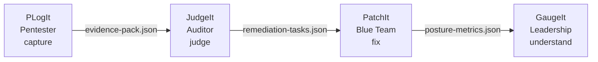

# The Suite - Master Specification

> **2026-11-02 REBASELINE (authoritative over July status claims).** Product boundaries and four-stage JSON direction remain proposed foundations. PLogIt application source is copied unchanged at commit 28aa156 and uses Spring Boot **4.1.1**, not the 3.5.16 in some older documents. The latest checked PLogIt main workflow passed all five CI validation areas but failed CD due to an unavailable verified SSH host-key fingerprint; **do not claim the latest commit is deployed**. JudgeIt, PatchIt and GaugeIt are still scaffolding-only. The current evidence JSON omits unapproved logs and attachment content; it is not yet the promised self-contained handoff. Read [2026 research](./Suite%20-%20Research%20Refresh%202026-11-02.md), [data contracts](./Suite%20-%20Handoff%20Contracts%20and%20Evidence.md) and [roadmap](./Suite%20-%20Modernization%20Roadmap.md) before acting. Historical text below captures July product intent; dated findings override stale implementation/status statements.

> **Status:** Foundational July 2026 vision, retained for architectural intent. The 2026-11-02 rebaseline above controls current implementation and deployment status.
> **What this is:** The single source of truth for the four-app cybersecurity suite, the pipeline it completes, the shared-nothing architecture, and the one-way JSON handoff that connects the apps.
> **Last updated:** 2026-07-26.

---

## 1. Executive summary

The Suite is four separate web applications that together complete the full lifecycle of a vulnerability, from the moment a pentester finds it to the moment leadership understands the business risk. Each app is a standalone product that does one job for one user. A customer can buy or use any one of them on its own. A customer who uses all four gets an unbroken chain of custody from raw capture to board-level reporting.

The four apps are PLogIt, JudgeIt, PatchIt, and GaugeIt. They do not share a database. They do not call each other over a network. They connect only through a single exported JSON file that one app produces and the next app imports. The flow is strictly one-way and strictly linear, like a baton pass in a relay race. If any one app crashes or corrupts, the other three keep running untouched.

The point of the Suite is not to build one big tool. It is to build four small ones, each owned by the person whose job it actually is, and to let them fit together for the customer who wants the whole chain.

---

## 2. The problem

A real security engagement touches four very different groups of people, and each group needs a different thing.

- The **pentester** needs to capture activity fast, honestly, and with evidence, before the notebook gets lost.
- The **auditor** needs to judge that activity, score it, and turn it into a defensible client report.
- The **blue team** needs to fix what was found, on assets they own permanently, against a deadline.
- **Leadership** needs to understand the overall risk and compliance posture without reading raw logs.

Today these four groups usually work in separate tools that do not talk to each other, or in one bloated tool that tries to serve all four and serves none of them well. The pentester's notes get retyped into the auditor's report. The auditor's report gets retyped into a ticketing system. The ticket data gets manually summarized into a slide deck for the board. Every handoff is manual, lossy, and a chance for the chain of custody to break.

The Suite removes the retyping. Each app does its one job, then hands a single JSON file to the next app, which picks up exactly where the last one left off.

---

## 3. The pipeline

The Suite is built around a four-stage remediation pipeline. Each stage is owned by one app and one user. Nothing skips a stage, and nothing flows backward.

The pipeline is progressive and one-way. PLogIt never talks to PatchIt directly. PatchIt never sends data back to JudgeIt. GaugeIt never reaches all the way back to PLogIt. Each app only needs to understand the JSON schema of the app directly before it, which keeps every app simple and every dependency local.

---

## 4. The foundational principle

PLogIt has a hard design rule that the whole Suite inherits: **capture everything, judge nothing.** PLogIt deliberately refuses to score severity, refuses to map CVEs, refuses to write client reports, and refuses to assign remediation deadlines. All of that judgment is pushed downstream to the app and the user whose job it actually is.

That principle is what makes four apps possible instead of one. Each app owns exactly the judgment that the previous app refused to make:

- PLogIt captures but does not judge.
- JudgeIt judges but does not fix.
- PatchIt fixes but does not strategize.
- GaugeIt strategizes but does not touch operational data.

If any one app started doing the next app's job, the clean separation would collapse and the Suite would turn back into a monolith. The boundaries are the product.

---

## 5. The four apps at a glance

| Stage | App | User | Primary verb | Primary entity | Status |
|---|---|---|---|---|---|
| Capture | **PLogIt** | Pentester | capture | log | built; latest production deployment not verified |
| Judge | **JudgeIt** | Auditor, assessment lead | judge | finding | planned |
| Fix | **PatchIt** | Blue team, engineers | fix | remediation ticket | planned |
| Understand | **GaugeIt** | CISO, leadership | understand | risk posture | planned |

Each app has one primary entity and one primary verb. That singularity is what lets each one ship at a focused scope instead of growing into a platform.

---

## 6. PLogIt (the capture layer)

> **Status:** Built; production deployment of the latest reviewed commit is blocked. This section documents PLogIt's suite role, not production verification.

**Who:** the pentester, the person in the trenches running scans, manual tests, and exploits against a scoped target.

**The job:** capture activity honestly and fast. PLogIt logs what was done, what was found, and the evidence for it, structured inside an engagement with scope and rules of engagement attached. It does not rate severity. It does not write the client report. It does not assign deadlines. Those are someone else's job, and PLogIt says so plainly in its own spec.

**What it produces:** an evidence pack, exportable as PDF (for a human to read), JSON (for the downstream app to ingest), and CSV (for tools or spreadsheets). The JSON and CSV formats exist today specifically because PLogIt anticipated a downstream tool consuming them. Building JudgeIt fulfills that written promise.

**What it deliberately does not do:**
- Severity, CVSS, CVE mapping.
- Findings as a distinct curated object.
- Client-facing branded reports.
- Remediation deadlines or SLAs.
- Cross-engagement trends.

**Its place in the pipeline:** PLogIt is the start. Nothing feeds into it. It produces the `evidence-pack.json` that JudgeIt ingests.

---

## 7. JudgeIt (the judgment layer)

> **Status:** Planned. The recommended second build.

**Who:** the assessment lead, the senior security consultant, the auditor. The person who turns raw pentest output into a defensible client deliverable.

**The problem:** a client cannot act on raw logs that say "ran nmap, found port 22." Someone has to translate raw activity into prioritized, severity-rated business risks, write the report, and set the deadlines. PLogIt refuses to do any of that, on purpose, which is exactly why JudgeIt exists.

**The job:** judge. JudgeIt ingests the evidence pack from PLogIt, promotes the raw logs into formal findings, scores them, attaches references, writes the client report, and assigns remediation SLAs.

**Core features:**
- **Pipeline ingestion.** Import the `evidence-pack.json` from PLogIt directly. The raw logs land in a review queue, nothing discarded, with the auditor's own layer of judgment added on top.
- **Finding promotion.** Convert raw activity logs into formal findings. A finding is a different entity from a log, with severity, references, affected assets, and a lifecycle that outlives any single engagement.
- **Scoring and SLA engine.** CVSS calculators, CVE references, deduplication of the same vuln across hosts, and remediation deadlines attached per finding (for example, critical equals 7 days, low equals 90 days).
- **Report generator.** Build the polished, branded client deliverable with methodology, executive summary, and a findings table. This is the report PLogIt explicitly excludes as someone else's job.
- **Cross-engagement trends.** See which clients keep making the same mistake, because findings outlive any single engagement.

**Why it is a real product, not a reskin:** PLogIt is engagement-centric and ephemeral, one pentest at a time. JudgeIt is finding-centric and persistent. A finding is tracked across clients, compared over time, and lives on after the engagement that produced it closes. The whole data model inverts.

**What it produces:** `remediation-tasks.json`, a file of formal findings with severity, SLAs, and target assets, ready for PatchIt to ingest. This file no longer contains the pentester's raw scratchpad notes. It contains the curated, scored, actionable output of judgment.

**What it deliberately does not do:**
- Fix anything.
- Own assets or track them over time.
- Aggregate risk at the leadership level.

**Its place in the pipeline:** JudgeIt sits second. It ingests from PLogIt and produces for PatchIt. It does not speak to PatchIt's format, only PLogIt's.

---

## 8. PatchIt (the fix layer)

> **Status:** Planned. The recommended third build.

**Who:** IT operations, system administrators, security engineers, and developers. The blue team. The people who actually have to patch what was found.

**The problem:** the blue team operates on continuous asset ownership, not on time-boxed engagements. Their unit is "the production billing server," not "the Q3 pentest of Acme." When the auditor hands over a report, the blue team needs to track who is patching what, whether the fix worked, and whether the deadline was met. Doing that in a spreadsheet is a nightmare.

**The job:** fix. PatchIt ingests the scored findings from JudgeIt, maps them to specific production assets, runs the remediation workflow, and closes the verification loop.

**Core features:**
- **Asset-centric ticketing.** Ingest the `remediation-tasks.json` from JudgeIt and map each finding to the specific production asset that needs patching. Assets are first-class, owned continuously, not borrowed for an engagement.
- **Remediation Kanban.** A workflow board built for patching: Triage, In Progress, Awaiting Re-test, Resolved, Risk Accepted. Each ticket carries the SLA clock from JudgeIt.
- **The verification loop.** When an engineer marks a ticket as fixed, the system flags it for a re-test by the pentester or auditor to verify the patch before the ticket formally closes. This is the loop that proves the fix actually worked.
- **SLA tracking.** Alerts and countdowns driven by the deadlines JudgeIt set. Breaches surface on the dashboard.
- **Risk over time.** Open criticals, SLA breaches, recurring findings on the same asset. The blue team's view is historical, because the same assets keep getting re-tested every quarter.

**Why it is a real product:** the pentester's job ends when the report ships. The blue team's job starts when the report arrives and never really ends. That continuous, asset-owned, SLA-driven worldview is structurally different from PLogIt's engagement-bounded capture or JudgeIt's finding-bounded judgment.

**What it produces:** `posture-metrics.json`, an aggregated file of patching data for a cycle (for example, monthly). It contains counts of tickets closed, mean-time-to-remediate (MTTR), and which assets are still vulnerable. It does not contain individual ticket back-and-forth. It contains the rolled-up picture.

**What it deliberately does not do:**
- Score severity. That was JudgeIt's job and the score came in with the finding.
- Render leadership dashboards. That is GaugeIt's job.
- Capture raw pentest activity. That is PLogIt's job.

**Its place in the pipeline:** PatchIt sits third. It ingests from JudgeIt and produces for GaugeIt. It does not speak to GaugeIt's format, only JudgeIt's.

---

## 9. GaugeIt (the understanding layer)

> **Status:** Planned. The recommended fourth build.

**Who:** CISOs, CTOs, compliance officers, and client stakeholders. Leadership. The people who pay for the security program and have to explain it to a board.

**The problem:** executives do not want to see raw markdown logs or individual patching tickets. They need a 10,000-foot view that translates technical vulnerabilities into business risk, compliance posture, and trends over time.

**The job:** understand. GaugeIt ingests the aggregated posture metrics from PatchIt and renders them as risk heatmaps, compliance mappings, and board-ready reports.

**Core features:**
- **Posture and trend analytics.** Visualizations of MTTR and risk posture over time, for example comparing Q1 to Q2 engagements. Leadership sees whether the program is getting better or worse.
- **Compliance mapping.** Map open vulnerabilities to regulatory frameworks, and flag when a current finding violates SOC 2, ISO 27001, or PCI DSS. This is the view the compliance officer lives in.
- **Asset risk heatmap.** Group vulnerabilities by target to expose whether one legacy server or IP range is the root cause of the most critical issues.
- **Board-ready reporting.** Generate high-level executive summaries focused on business impact and mitigation return on investment. The technical weeds are stripped out, because they already live in PatchIt and JudgeIt.

**Why it is a real product:** leadership's question is never "what did we find." It is "are we getting safer, and where is the biggest risk." That question needs aggregated, trended, compliance-framed data, which is a different shape from anything the upstream apps produce.

**What it produces:** GaugeIt is the end of the line. It produces reports and dashboards for humans. It does not export a JSON file to a downstream app, because there is no downstream app.

**What it deliberately does not do:**
- Touch operational data. It only reads aggregated metrics.
- Score, fix, or capture anything.

**Its place in the pipeline:** GaugeIt sits last. It ingests from PatchIt. Nothing follows it.

---

## 10. Architecture: shared-nothing

The Suite is four separate web applications with four separate databases. There is no shared database, no shared service, no shared filesystem, and no real-time network connection between any two apps.

This is a deliberate choice with three payoffs.

1. **Blast-radius containment.** If PatchIt crashes or its database corrupts, PLogIt, JudgeIt, and GaugeIt are completely unaffected. A failure in one app cannot cascade into the others, because there is no coupling to cascade through.
2. **Standalone sales.** A firm that already has a pentesting tool can buy just JudgeIt, or just PatchIt. They are not forced to adopt the whole suite to get value from one piece. Each app has to earn its place on its own.
3. **Simpler builds.** Each app only needs to understand the JSON schema of the app directly before it. There is no cross-app data model to design, no distributed transaction to coordinate, and no version-skew headache across four codebases.

The cost is that the apps cannot query each other live. A user who wants the latest PatchIt status inside JudgeIt has to wait for the next JSON export. For a security pipeline that runs in cycles (engagements, reports, patch sprints, quarterly reviews), that latency is fine. Real-time sync is not the use case.

---

## 11. The handoff protocol

The four apps connect through one mechanism only: a single JSON file that one app exports and the next app imports.

The rules of the protocol are strict.

- **One-way only.** Data flows PLogIt to JudgeIt to PatchIt to GaugeIt. Never backward. PatchIt never sends data back to JudgeIt. JudgeIt never reaches down into PLogIt.
- **Linear, no skipping.** PLogIt never talks to PatchIt directly. Every piece of data passes through JudgeIt first, so JudgeIt's judgment is always applied before anything reaches the fix layer.
- **One file, one schema per link.** Each handoff is a single JSON file with a defined schema. Each app only needs to parse the schema of the app directly before it. PLogIt does not need to know PatchIt's format. PatchIt does not need to know PLogIt's format.
- **Self-contained evidence is a target, not yet achieved.** PLogIt's current JSON includes attachment filenames without bytes or hashes and excludes non-approved logs. Decide a versioned self-contained representation or explicit evidence bundle and test real producer/consumer compatibility before advertising full portability.
- **Air-gap friendly.** Because the handoff is a file, the Suite works in highly secure or air-gapped environments where apps cannot talk to each other over a network. A user can move the file on a USB stick if they have to.

This makes each link a small, testable contract. The schema of `evidence-pack.json` is a boundary PLogIt owns and JudgeIt consumes. Get that contract right, and the two apps are decoupled forever.

---

## 12. The three handoffs in detail

### Handoff 1: PLogIt to JudgeIt

- **File:** `evidence-pack.json`
- **Producer:** PLogIt, on leader export.
- **Consumer:** JudgeIt, on import.
- **Contents:** engagements, raw logs, markdown descriptions and results, code blocks, attachment references, timestamps, scope and rules of engagement, author and review-state metadata. The full honest capture, no judgment added.
- **What happens on import:** JudgeIt maps the raw logs into a review queue. The auditor begins judging, promoting logs to findings, scoring severity, and assigning SLAs. Nothing from the evidence pack is discarded. JudgeIt only adds its layer on top.

### Handoff 2: JudgeIt to PatchIt

- **File:** `remediation-tasks.json`
- **Producer:** JudgeIt, when the auditor finalizes.
- **Consumer:** PatchIt, on import.
- **Contents:** formal findings with severity, CVSS or other scores, CVE references, affected target assets, remediation SLAs and deadlines. This file does not contain the pentester's raw scratchpad notes. It contains the curated, scored, actionable output of judgment.
- **What happens on import:** PatchIt creates remediation tickets tied to the specific assets, starts the SLA clocks, and populates the Kanban. PatchIt does not need to understand PLogIt's format, because it only ever talks to JudgeIt.

### Handoff 3: PatchIt to GaugeIt

- **File:** `posture-metrics.json`
- **Producer:** PatchIt, at the end of a cycle (for example, monthly).
- **Consumer:** GaugeIt, on import.
- **Contents:** aggregated data, not individual tickets. Counts of tickets closed, mean-time-to-remediate, assets still vulnerable, SLA breach counts, severity breakdowns over the period.
- **What happens on import:** GaugeIt translates the metrics into risk heatmaps, compliance dashboards, and trend charts for leadership.

---

## 13. The golden thread: shared IDs

For four separate databases to pass data without corrupting it or creating duplicates, they need a shared language for identity. That language is the UUID.

PLogIt currently persists UUIDs for every log (confirmed in its Java entity); the historic claim that UUIDs are generated client-side must not be assumed from the current code. This is the golden thread that runs through the whole Suite.

- When JudgeIt ingests a PLogIt log, it stores the original log UUID inside the finding it creates.
- When PatchIt ingests a JudgeIt finding, it keeps the finding ID (which carries the source log UUID) on the ticket.
- When GaugeIt aggregates PatchIt data, the asset and finding IDs are preserved so trends can be traced back.

The rule is simple: **an app never reassigns an ID it received.** It stores it as-is and references it. If a record is updated anywhere in the chain, the UUID lets every app know exactly which log, finding, or ticket is being talked about, with no ambiguity and no duplication.

---

## 14. Design philosophy

The Suite follows the Unix philosophy: do one thing well, and pipe the output to the next tool. Four small, sharp tools beat one big, vague platform, for three reasons.

1. **Each app earns its place.** Because each one has to work standalone, it has to be genuinely useful on its own. There is no hiding a weak app inside a suite bundle.
2. **Each user gets a tool shaped for them.** The pentester gets a capture tool, not a reporting tool. The auditor gets a judgment tool, not a ticketing tool. Nobody fights an interface designed for someone else's job.
3. **The chain of custody is honest.** Because the handoffs are explicit files with explicit schemas, the path from raw log to board report is auditable end to end. Nothing transforms invisibly inside a monolith.

The trade-off the Suite accepts is integration friction. A customer using all four has to move files between apps, at least at first. A future enhancement (see section 17) could add optional API-key sync for suite customers who want the file moves automated, but the file handoff stays as the baseline because it keeps the apps decoupled and air-gap friendly.

---

## 15. Naming and brand

The four apps share a naming family: a real verb plus "It".

| App | Verb | Why the verb fits |
|---|---|---|
| PLogIt | log | The actual verb a pentester does. |
| JudgeIt | judge | The auditor's whole job is judgment. |
| PatchIt | patch | The word every blue-teamer uses for fixing a vuln. |
| GaugeIt | gauge | To gauge is to measure or assess, which is what a risk dashboard does. |

The shared suffix signals "these belong together" without being precious about it, because every verb is a real word the target user actually uses. In a nav bar, a docs folder, or a sales deck, the four read instantly as a family: PLogIt, JudgeIt, PatchIt, GaugeIt.

**Honest caveat:** trademark and domain checks have not been done. JudgeIt, PatchIt, and GaugeIt are common words with a common suffix, so they may already be trademarked or registered by someone. These are working names to verify before any of them go on a domain, a repo, or a landing page. If one conflicts, that one app gets renamed, and PLogIt (which is already deployed) stays as-is.

---

## 16. Build order

The recommended build order is the pipeline order.

1. **PLogIt** (built; CD readiness remains open). Capture layer source exists and passes CI, but the latest reviewed production deployment fails the mandatory SSH fingerprint preflight.
2. **JudgeIt** (next). The recommended second build, for two reasons.
   - PLogIt already exports JSON and CSV today, and its docs call those formats "for tool ingestion." Building JudgeIt fulfills that written promise.
   - JudgeIt has one clear primary entity (the finding) and one clear job (judge). It is the smallest, sharpest of the three remaining apps. Building it second proves the inter-app handoff pattern on the simplest possible build before the bigger ones.
3. **PatchIt** (third). Bigger than JudgeIt, because asset ownership, SLA clocks, and the verification loop pull in ticketing and dashboards. By the time it is built, the handoff pattern is already proven.
4. **GaugeIt** (last). Pure aggregation and visualization. It depends on the upstream apps existing to produce data, so it naturally comes last.

---

## 17. Open questions and future enhancements

These are not decided yet. They are recorded here so they are not lost.

- **Optional API-key sync for suite customers.** The file handoff is the baseline and stays the baseline. A future enhancement could let a suite customer paste an API key from PatchIt into JudgeIt, so JudgeIt POSTs the JSON directly to PatchIt's ingestion endpoint instead of requiring a manual file move. This is additive, not a replacement for the file flow.
- **Webhooks for backward status.** A strictly one-way flow means PatchIt cannot tell JudgeIt when a ticket is fixed. A future webhook could fire a status update backward (PatchIt to JudgeIt: "ticket 45 is fixed, awaiting re-test"). This would be opt-in and would not change the forward file flow.
- **Per-app tech stack.** PLogIt is Spring Boot, React, and PostgreSQL. The other three have not chosen their stacks yet. They could match PLogIt for consistency, or pick whatever fits each app's size and shape. This gets decided when each app is scoped.
- **The JSON schemas themselves.** The three handoff files (`evidence-pack.json`, `remediation-tasks.json`, `posture-metrics.json`) need formal schemas. The evidence pack schema partly exists today in PLogIt's export code. The other two get designed when JudgeIt and PatchIt are scoped.
- **Real users versus portfolio builds.** PLogIt became a personal project. Whether the other three are built for a real audience (a firm, a team, clients) or as portfolio and learning projects changes how much weight goes on interop polish versus each app standing alone. This is a question for the user.

---

## 18. Status of each app

| App | Status | Notes |
|---|---|---|
| PLogIt | built; current deployment not verified | Five current CI validations passed, but main CD was blocked on a missing SSH host fingerprint (2026-11-02). |
| JudgeIt | planned | Recommended next build. Smallest of the three. |
| PatchIt | planned | Third build. Pulls in asset ownership and SLA tracking. |
| GaugeIt | planned | Last build. Pure aggregation and visualization. |

---

## 19. Where to go next

When the user is ready to move, the next step is to scope **JudgeIt** in detail: data model, features, the formal `evidence-pack.json` ingestion schema, the `remediation-tasks.json` export schema, the user flows, and the tech stack. That scoping becomes JudgeIt's own Product Spec, the same way PLogIt has one.

Phase: Intake, suite level. Names locked, architecture locked, pipeline locked. Nothing new is built. Waiting for the user to pick the next move.

---

*End of master spec. This is the source of truth for the Suite. Each app gets its own spec when it is scoped.*
